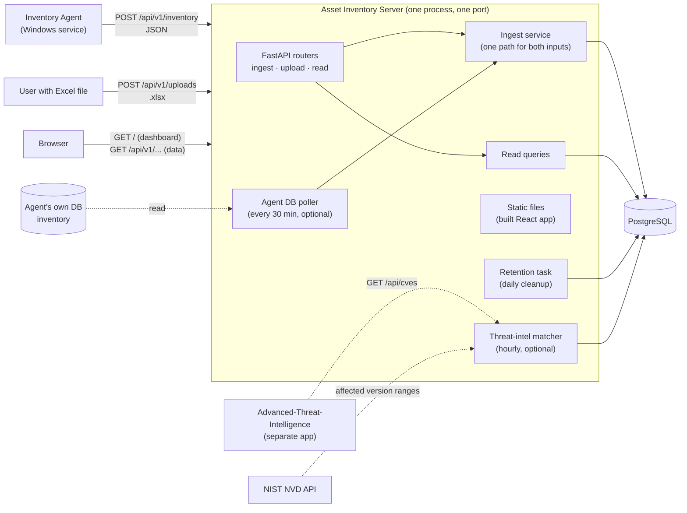
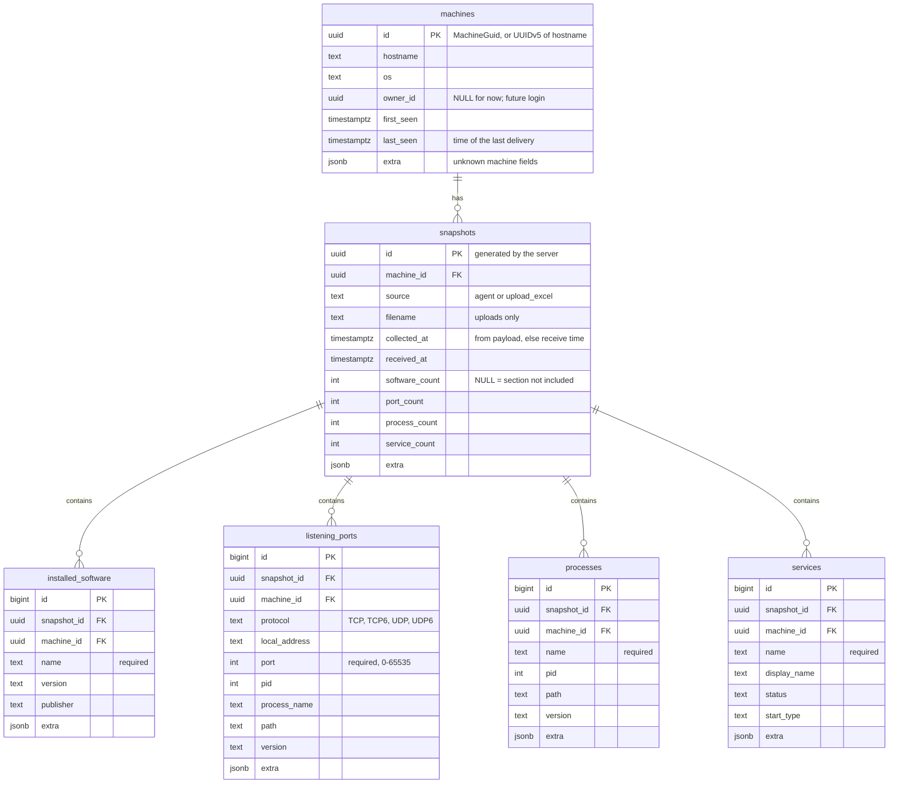

# Asset Inventory Server: Design

Status: proof of concept · Last updated: 2026-11-25

Related: [README.md](../README.md) (setup and running) · [COLLECTOR_API.md](COLLECTOR_API.md) (agent API)

## Contents

1. [Purpose and scope](#1-purpose-and-scope)
2. [Architecture](#2-architecture)
3. [Snapshots and current state](#3-snapshots-and-current-state)
4. [Data model](#4-data-model)
5. [Data inputs](#5-data-inputs)
6. [API](#6-api)
7. [Dashboard](#7-dashboard)
8. [Environments and deployment](#8-environments-and-deployment)
9. [Security](#9-security)
10. [Data volume and retention](#10-data-volume-and-retention)
11. [Design decisions](#11-design-decisions)
12. [Limitations and future work](#12-limitations-and-future-work)

## 1. Purpose and scope

The goal is to know, for every Windows machine in scope, **which software is installed (with versions) and which
network ports are open**, plus the running processes and services, and to see how that changes over time.

Data comes from two sources:

- **Agents.** The Inventory Agent (a C++ Windows service) collects data every 5 minutes and sends it to this server.
- **Excel uploads.** For machines where no agent can be installed, someone fills in a workbook and uploads it.

**In scope:** receiving and validating data, storing full history, a dashboard for current state and history,
Excel import, and (optional) matching the installed software against known vulnerabilities from the separate
Advanced-Threat-Intelligence (ATI) app (section 5.4).

**Not in scope yet:** user login and per-user visibility, comparing two snapshots, alerts (for example a new exposed
port), editing data in the dashboard.

## 2. Architecture



| Component | Technology | Role |
|---|---|---|
| API server | Python 3.12, FastAPI, uvicorn | Receives deliveries and uploads, answers dashboard queries, serves the dashboard files |
| Validation | Pydantic 2 | Checks incoming JSON; keeps unknown fields |
| Database access | SQLAlchemy 2 (sync) + psycopg 3 | Queries and inserts |
| Migrations | Alembic (hand-written) | Creates and changes tables |
| Database | PostgreSQL 16+ | Storage. JSONB holds flexible fields. |
| Excel parsing | openpyxl | Reads `.xlsx` uploads |
| Threat intelligence | httpx; ATI (separate Python app) and the NVD API | Optional. CVE candidates and risk data from ATI, exact affected versions from NVD (section 5.4) |
| Dashboard | React 19, TypeScript, MUI 9, MUI X DataGrid, TanStack Query, React Router, Vite | Web UI |

**One process, one port.** In production the React app is built into static files, and FastAPI serves them next
to the API. The dashboard calls the API with relative URLs (`/api/v1/...`), so the browser always talks to a single
address. There's no separate web server, no CORS, and no API address to configure per environment. In development,
Vite serves the dashboard on port 5173 and forwards `/api` to FastAPI on port 8000, which gives the browser the
same single-address view.

### Request flow for a delivery

1. The agent POSTs one JSON object (or a list) to `/api/v1/inventory`.
2. If `INGEST_API_KEY` is set, the `X-API-Key` header is checked (401 if wrong).
3. Pydantic validates the body (422 with the field path if invalid). Unknown fields are kept.
4. For each machine in the request, in one database transaction:
   1. Upsert the `machines` row (create it, or update hostname/OS and `last_seen`).
   2. Insert a `snapshots` row with a server-generated UUID, the source, `collected_at` and one count per section.
   3. Bulk-insert the section rows (software, ports, processes, services), each pointing to the snapshot.
5. Commit and return 201 with the new snapshot ids and row counts.

Excel uploads follow the same path from step 3: the workbook is converted into the same delivery objects and
stored by the same function (`services/ingest.py::store_delivery`).

## 3. Snapshots and current state

This is the central design idea.

**Every delivery is a snapshot.** Each agent run or Excel upload creates one new `snapshots` row per machine.
Nothing is updated or deleted when new data arrives, so the database holds the full history of every machine.

**Current state = the latest snapshot, per machine and per section.** For each machine and each section
(software, ports, processes, services), the current rows are those of the newest snapshot that **included that
section**. "Newest" is decided by `collected_at`, the time the agent collected the data, not the time it arrived.

Two rules follow from this, both needed by the agent's behaviour:

| Situation | What happens | Why |
|---|---|---|
| The agent was offline, buffered data, and sends it hours later with the original timestamps | The late snapshot is stored in history at its real time and does **not** replace newer data | Ordering is by `collected_at`, not by arrival |
| A delivery contains only some sections (for example ports every 5 minutes, software once an hour) | Missing sections keep showing their previous data | Each snapshot records a count per section. `NULL` means "not included", which is different from `0` ("included, none found"). |

Snapshot ids are always generated by the server; agents never send them.

**Machine identity.** A machine's id is the Windows `MachineGuid` sent by the agent, which stays the same if the
machine is renamed. If no id is sent (for example from Excel), the id is derived from the lowercased hostname
(UUIDv5), so the same hostname always maps to the same machine. Because of this, an Excel row for a machine that
also has an agent creates a **separate** machine record unless the workbook includes the agent's `machine_id`.

## 4. Data model

PostgreSQL database `asset_inventory`, six tables, managed by Alembic (`backend/alembic/versions`).



Notes:

- **Minimal required fields.** Only machine `id` or `hostname`, the software/process/service `name` and the port
  number are required. Everything else is optional, because the collector's format is still evolving.
- **`extra` JSONB on every table** stores fields the server doesn't know yet. An agent can start sending a new field
  before the server has a column for it, and nothing is lost. When a field becomes important, it gets a real column
  through a migration.
- **`machine_id` is repeated** on the section tables, so per-machine queries don't need to join through `snapshots`.
- **Cascading deletes:** deleting a snapshot deletes its rows; deleting a machine deletes everything for it.
- **Indexes:** `snapshots(machine_id, collected_at DESC)` for "latest snapshot per machine";
  `snapshots(received_at DESC)` for the history page; `snapshot_id` and `machine_id` on every section table;
  `machines(owner_id)` for future per-owner filtering.
- **Views for ad-hoc SQL** (pgAdmin, reports): `current_installed_software`, `current_listening_ports`,
  `current_processes`, `current_services` return only current rows, using the rules in section 3. Example:

  ```sql
  SELECT m.hostname, p.protocol, p.port, p.process_name
  FROM current_listening_ports p JOIN machines m ON m.id = p.machine_id
  WHERE p.local_address NOT LIKE '127.%' AND p.local_address <> '::1'
  ORDER BY m.hostname, p.port;
  ```

**Exposed port:** a listening port whose `local_address` is not a loopback address (`127.*`, `::1`). It can be
reached from the network, for example `0.0.0.0` or `::`.

**Threat-intelligence tables** (migration `0002`; they hold derived data and can be rebuilt by a scan):

| Table | Holds |
|---|---|
| `threat_matches` | One row per **application** (name + version) and CVE: status (`vulnerable` / `review` / `ruled_out`), the reason, the matched ATI vendor/product, the matching version range and fixed version, severity, CVSS, EPSS, CISA KEV and exploit flags, a short AI summary. Unique on (name, version, CVE). Not tied to a machine: the API joins it to each machine's *current* software, so every machine with that version gets the finding and a finding disappears the moment the version is no longer installed. |
| `threat_cve_ranges` | Cache of the affected products and version ranges NVD lists for a CVE (JSONB list of `{vendor, product, version, start_incl, start_excl, end_incl, end_excl}`), with the fetch time. An empty list means NVD has not attached product data yet. |

## 5. Data inputs

### 5.1 Agent JSON

The full contract for agent developers is in [COLLECTOR_API.md](COLLECTOR_API.md). In short: one JSON object per
collection cycle, with `collected_at`, a `machine` object, and optional lists `installed_software`,
`listening_ports`, `processes` and `services`. Keys match the table and column names above.

### 5.2 Excel upload

`.xlsx` only, up to `MAX_UPLOAD_MB` (20 MB). One sheet per table, first row = column headers. Sheet and column
names are case-insensitive, and spaces count as underscores.

| Sheet | Columns (bold = required) |
|---|---|
| `machines` (optional) | **hostname**, os, machine_id |
| `installed_software` | **hostname**, **name**, version, publisher |
| `listening_ports` | **hostname**, protocol, local_address, **port**, pid, process_name, path, version |
| `processes` | **hostname**, **name**, pid, path, version |
| `services` | **hostname**, **name**, display_name, status, start_type |

Rules:

- Rows are grouped by `hostname` into **one snapshot per machine** per upload.
- A missing sheet means that section isn't included, so the machine keeps its previous data for it.
- Unknown sheets are ignored. Unknown columns go into `extra`.
- Text columns stay text, even when Excel stored them as numbers (version `8` stays `"8"`).
- **All or nothing:** if any row is invalid, nothing is saved, and the response lists every problem with its sheet
  name and row number.
- Sample file: [samples/sample_inventory.xlsx](../samples/sample_inventory.xlsx).

### 5.3 Polling the agent's database (bridge)

Today the agent writes each cycle into its own PostgreSQL database (`inventory`) instead of calling the API. When
`AGENT_DB_URL` is set, a background task (`services/agent_poller.py`) reads that database every
`AGENT_POLL_MINUTES` (default 30):

- Rows sharing `(machine_id, collected_at)` form one cycle and become one snapshot (source `agent`, original
  `collected_at`), stored through the same `store_delivery` as the API, oldest first, one commit per cycle.
- Only cycles collected **after the newest agent snapshot already stored for that machine** are read, so polls never
  create duplicates. Cycles the agent buffered while offline are still imported: it writes them oldest first,
  before the current cycle. A machine seen for the first time is imported back to `RETENTION_DAYS`.
- A table with no rows for a cycle (for example software when `CollectInstalledSoftware=false`) means that section
  isn't included, so its previous data stays current (section 3).
- Data now arrives once per poll, so `ONLINE_MINUTES` must be larger than `AGENT_POLL_MINUTES` (for example 35);
  the server logs a warning otherwise. `GET /api/health` reports the last poll, how many cycles it imported, and
  the last error.

This goes away once the agent POSTs to `/api/v1/inventory`; then `AGENT_DB_URL` is left empty.

### 5.4 Threat intelligence (Advanced-Threat-Intelligence)

ATI is a separate app that collects CVEs from NVD, the CISA KEV catalog, EPSS and exploit repositories into its own
database and serves them over HTTP. It does not know what is installed on our machines (its asset-matching tables
exist but nothing fills them). This server does that correlation. It is **optional**: it runs only when `ATI_URL`
is set, ATI keeps its own code, database and port (use 8001 locally), and nothing is copied between the two repos.

A scan (`services/threat_intel.py`) runs every `ATI_POLL_MINUTES` (default 60), or when someone presses **Scan now**:

1. **Applications.** Take every distinct installed application (name, version, publisher) from the machines'
   current software.
2. **Candidates (ATI).** From the application name, take the word that identifies the product (the first word that is
   not just the publisher's name; noise such as "Inc", "Runtime", "x64", "KB123456" is skipped). Ask ATI for CVEs
   containing it (`GET /api/cves?search=`). Keep a CVE only if ATI's product contains that word **and** ATI's vendor
   agrees with the publisher or the application name. This is where severity, CVSS, EPSS, CISA KEV, exploit flags and
   the AI summary come from.
3. **Affected versions (NVD).** Fetch each candidate CVE's affected products and version ranges from NVD
   (`threat_cve_ranges` cache, `NVD_RANGE_TTL_DAYS`). At most `NVD_MAX_LOOKUPS` CVEs are fetched per scan, riskiest
   first (CISA KEV, public exploit, CVSS), and requests are spaced to respect NVD's limit (5 per 30 s, 50 with
   `NVD_API_KEY`). Scans converge over time; findings not yet checked show as `review`.
4. **Decision.** Compare the installed version with every range NVD lists *for that product*, honouring both lower
   and upper bounds and exact versions.

| Status | Meaning |
|---|---|
| `vulnerable` | Installed version is inside an affected range and the product name matches well (every word of the name appears in ATI's vendor/product) |
| `review` | Product matches but it cannot be decided: ranges not fetched yet, version unreadable, NVD has no product data for the CVE, the CVE's NVD product list lacks this application, or only part of the name matched |
| `ruled_out` | Installed version is outside every affected range. Kept so analysts can see why a CVE was dropped; hidden from the default views. |

**Why NVD for versions instead of ATI.** ATI reports one vulnerable range per CVE, taken from the first NVD entry
that has an upper bound. Products with several release branches get wrong answers. Tested against real data:
CVE-2024-10979 lists `>= 12.0, < 12.21`, `>= 13.0, < 13.17`, ... `>= 16.0, < 16.5`; ATI reports only `< 12.21`, which
made PostgreSQL 16.2 look safe. Reading NVD directly flags it correctly (fixed in 16.5) and rules out 16.16.
A false "safe" is the worst failure for this feature, so ranges are never taken from ATI.

**Risk score (0 to 100)**, used to order findings: `CVSS × 5 + 30 (CISA KEV) + 15 (public exploit) + EPSS × 15`,
capped at 100.

**Ports.** Each finding lists the machine's current listening ports whose program path or name contains the
application's product word (for example port 8080 served by a file under `...\Acrobat DC\...`), and whether any is
exposed.

**Failure behaviour.** If ATI is unreachable the scan fails, the error is shown on the page and in `/api/health`, and
the previous findings are kept. If ATI's search fails for one word, the findings of the applications that use that word
are kept. If NVD refuses a request (403/429) the scan stops fetching and finishes with what it has. A failed NVD fetch is
not cached. Concurrent scans are refused (409).

## 6. API

Base path `/api/v1`. Interactive documentation is at `/api/docs` (Swagger), and the schema at `/api/openapi.json`.

| Method | Path | Purpose |
|---|---|---|
| POST | `/inventory` | Agent delivery: one object or a list. Requires `X-API-Key` if `INGEST_API_KEY` is set. |
| POST | `/uploads` | Excel upload (multipart field `file`) |
| GET | `/stats?machine_id=&os=&status=&hours=` | Dashboard numbers: machines, online, snapshots in the period, unique apps, exposed ports, top software, top ports, recent snapshots. Optional filters: `machine_id` (repeatable), exact `os`, `status` (`online`/`offline`), `hours` (period for the snapshot count and list, default 24, max 2160). |
| GET | `/machines?q=&limit=&offset=` | Machine list with online flag, snapshot count and current section counts |
| GET | `/machines/{id}` | One machine |
| GET | `/machines/{id}/snapshots` | One machine's snapshot history (newest first by `collected_at`) |
| GET | `/machines/{id}/{section}?snapshot_id=` | Rows of `software`, `ports`, `processes` or `services`. Current state by default, or a specific snapshot. |
| GET | `/snapshots?source=` | All deliveries across machines (newest first by arrival), filterable by `agent` / `upload_excel` |
| GET | `/snapshots/{id}` | One snapshot |
| GET | `/software?q=` | Current software across all machines, grouped by name, publisher and version, with the list of machines |
| GET | `/ports?q=&exposed_only=` | Current listening ports across all machines, grouped by protocol, port and process, with an exposed flag |
| GET | `/vulnerabilities?status=&machine_id=&q=&kev_only=&exploit_only=&severity=&limit=&offset=` | Findings, riskiest first: one row per machine, application and CVE, with risk, severity, CVSS, EPSS, KEV/exploit flags, version range, fixed version, matched ATI product, reason and tied listening ports. `status`: `actionable` (default: vulnerable + review), `vulnerable`, `review`, `ruled_out`, `all`. |
| GET | `/vulnerabilities/summary?machine_id=` | Counts for findings that need action: findings, machines, applications, CVEs, vulnerable, review, KEV, exploit, by severity, top 10 CVEs |
| GET | `/vulnerabilities/status` | Whether ATI is enabled, last scan time/result/error, cached ranges, stored findings |
| POST | `/vulnerabilities/scan` | Start a scan now (202; 503 if `ATI_URL` is unset; 409 if one is running). Poll `/vulnerabilities/status`. |
| GET | `/api/health` | Health check (also checks the database connection); with `AGENT_DB_URL` set, also the last agent-DB poll; with `ATI_URL` set, also the threat-intel status |

## 7. Dashboard

| Page | Shows |
|---|---|
| Dashboard | Summary cards, most installed software, most common ports, latest deliveries. A filter bar (machines, OS, online/offline, snapshot period of 24 h / 7 days / 30 days) applies to everything on the page and is kept in the URL. |
| Machines | Searchable table: hostname, OS, last seen, online, snapshot count, current counts |
| Machine detail | Snapshot picker (defaults to latest) and tabs for Software, Ports (exposed ports highlighted), Processes, Services |
| Software | Fleet-wide software list. Each row expands to the machines that have it. |
| Ports | Fleet-wide port list with an "exposed only" switch |
| Vulnerabilities | Findings from the ATI matching (section 5.4): summary cards, filters (status, search, CISA KEV, public exploit), a table ordered by risk, and a detail dialog with the reason, matched ATI product, version range and the application's listening ports. **Scan now** starts a scan. Shows setup instructions when `ATI_URL` is unset. The Dashboard shows a "Vulnerable software" card when ATI is enabled. |
| Snapshots | Every delivery: machine, source, file name, collected and received times, counts |
| Upload Excel | Drag and drop an `.xlsx`, then see the result or the list of errors |

Light and dark themes are supported. "Online" means the machine sent data within `ONLINE_MINUTES` (default 15).
Every page re-fetches its data every 5 minutes, so open dashboards show new deliveries without a reload.

## 8. Environments and deployment

The same code and the same start command (`python -m app`) run everywhere. Only `.env` and the address agents send
to change.

| | Local (developer laptop) | Hosted server |
|---|---|---|
| App listens on | `127.0.0.1:8080`, this computer only | `127.0.0.1:8080`, behind nginx |
| HTTPS | no | nginx (`deploy/nginx.conf`) |
| Keeps running | started by hand (`scripts/run.ps1`) | systemd service (Linux) or Windows service |
| Agents send to | `http://localhost:8080` | `https://<domain>` |
| `INGEST_API_KEY` | empty | set |

nginx is only a pass-through for HTTPS; it doesn't change paths. That's why nothing in the code or the dashboard
differs between local and hosted. Docker files exist in `deploy/` for a Linux server where Docker is allowed. They
are untested, because Docker isn't approved on the development laptop. Steps are in the README.

## 9. Security

**Current state (PoC):**

- There's no login. Anyone who can reach the server can read the dashboard and upload Excel files.
- **Ingest key:** if `INGEST_API_KEY` is set, agent deliveries must send it in `X-API-Key` (compared in constant
  time). It isn't applied to the dashboard or Excel upload: a key in the browser page would be readable by anyone.
- By default the server listens on `127.0.0.1` only, so nothing is exposed until someone sets `HOST=0.0.0.0` or puts
  nginx in front.
- The app's database user (`inventory_app`) owns only its own databases; the `postgres` superuser is used only during
  setup.
- `.env` holds the database password and the key, and is excluded from git.
- **Threat intelligence (optional):** the server makes outbound requests only to `ATI_URL` and the NVD API; nothing
  from the inventory is sent to either (ATI gets a product word as a search term, NVD gets a CVE id). The findings
  endpoints are as open as the rest of the dashboard until login exists. `NVD_API_KEY` is optional and goes in `.env`.

**Planned (ownership-ready).** The code is already shaped for per-user visibility:

- `machines.owner_id` exists (currently always NULL).
- Every read query goes through one filter, `deps.scope_machines()`, which today returns everything.
- Every route asks one function for the caller, `deps.get_current_owner()`, which today returns `None`.

To add login: create `users` and `api_keys` tables, make `get_current_owner()` resolve the agent's API key or the
user's session to an owner, store it on the machine at ingest, and filter in `scope_machines()`. Routes and pages
stay the same.

## 10. Data volume and retention

- One agent sends a snapshot every 5 minutes, about 288 snapshots and around 250,000 rows per machine per day
  (around 900 rows per cycle).
- `RETENTION_DAYS` (default 30) limits history. A background task deletes older snapshots once a day, and their rows
  are removed by cascade. `0` keeps everything.
- Recommended for the agent: send installed software less often (for example hourly), since it rarely changes.
  Partial deliveries are supported (section 3).
- Duplicate deliveries (for example after a network retry) are stored as separate snapshots. This is harmless for
  current state and acceptable for the PoC.

## 11. Design decisions

| Decision | Why | Alternatives considered |
|---|---|---|
| Append-only snapshots | Full history; comparisons later are a query, not a redesign; late replays can't damage current data | Overwrite current rows (simpler, but loses history) |
| Order by `collected_at` | The agent buffers offline and replays later with original timestamps | Order by arrival (a late replay would overwrite newer data) |
| Per-section counts with NULL = not included | Lets agents send sections at different rates | Require every section in every delivery |
| Few required fields + `extra` JSONB | The collector's format is still changing; nothing is lost | Strict schema (rejects deliveries when the agent adds a field) |
| One ingest path for agents and Excel | Same validation and storage rules; one place to test | Separate Excel import logic |
| Server-generated snapshot ids | The server owns history; agents stay simple | Agent-supplied ids |
| FastAPI serves the built dashboard | One process, one port, no CORS, no per-environment config | Separate web server or nginx locally |
| PostgreSQL native on Windows, no Docker | Docker isn't approved on the development laptop | Docker Compose |
| Sync SQLAlchemy and routes | Simpler code; load is low (one request per agent every 5 minutes) | Async stack |
| ATI stays a separate app, used over HTTP | It has its own owner, code, database and release cycle (and no license file to copy under); the integration is one client module | Copy ATI into this repo; modify ATI to do the matching |
| Affected versions from NVD, not from ATI | ATI keeps one range per CVE, which gives false "safe" results for multi-branch products (section 5.4) | Trust ATI's `vuln-version` endpoint |
| Findings keyed by application, joined at read time | Same finding on every machine with that version; stale findings vanish when the version changes | One row per machine and CVE (more rows, goes stale) |
| Show `ruled_out` and `review`, not only `vulnerable` | Name matching is heuristic; analysts need to see what was dropped and what is undecided | Show confirmed findings only |
| Excel only, no CSV/JSON upload | One format that non-technical users can fill in; multiple sheets in one file | CSV per section |

## 12. Limitations and future work

| Area | Today | Next step |
|---|---|---|
| Authentication | No login; optional shared agent key | Users, per-owner API keys, `scope_machines` filtering (section 9) |
| Agent | Writes to its own database; the server polls it every 30 minutes (section 5.3) | Agent POSTs to this API ([COLLECTOR_API.md](COLLECTOR_API.md)) |
| Comparisons | View any snapshot | Diff two snapshots: software added/removed/upgraded, ports opened/closed |
| Alerts | none | New exposed port, unapproved software, a new CISA KEV finding |
| Duplicates | Retries create duplicate snapshots | Idempotency key per delivery |
| Python dependencies | Not version-pinned | Pin versions (or a lock file) before deploying |
| Linux deployment | Documented steps; Docker files untested | Setup script and systemd unit once a server is chosen |
| Multiple workers | One uvicorn process | With several workers, move the retention task and the threat-intel scan to a scheduled job so they run once |
| Product matching | By name (a product word plus vendor agreement), so look-alike names can match: for example "Visual C++ Redistributable" can match Visual Studio CVEs. The detail dialog shows the matched product. | Match on CPE identifiers (agent reads them, or a CPE dictionary lookup) |
| CVEs without product data | ATI stores vendor/product "Unknown" for CVEs NVD has not analysed yet; they cannot be matched | Re-fetch in ATI later, or match on the CVE description |
| Scan speed | At most `NVD_MAX_LOOKUPS` (15) NVD fetches per scan without a key, so the first full pass takes many scans | Set `NVD_API_KEY` and raise `NVD_MAX_LOOKUPS` |
